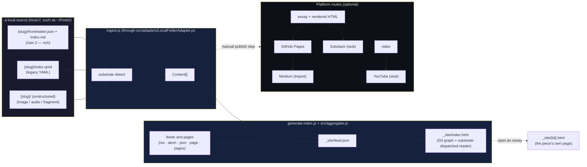

# post-pipe Architecture & Design Decisions

**Last updated:** 2026-11-08

---

## What This Is

post-pipe is a **corpus viewer with optional publishing routes** — not a blog pipeline.

You point it at a site: a folder holding `settings.json` and `feeds.opml` (`POSTPIPE_SITE`; with none set, the example site in `examples/site/`, which reads two public feeds). Its sources are folders of writing (`local://<path>` in `feeds.opml`, such as `~/Posts/`), published feeds and single pages. It walks each folder, detects what kind of content each subfolder contains (essay, image, audio, video, multi-substrate work, archive, fragment, link), and produces a spatial graph view of your entire intellectual topology. When a piece is text and wants to travel, publishing routes exist for GitHub Pages and, through it, Medium (Substack and YouTube are stubs) — but publishing is a *capability*, not the purpose.

Metadata is a gradient, not a gate. Folders with rich `frontmatter.json` produce rich nodes (topology, energy, forms, explicit edges). Folders with legacy `.qmd` YAML read in a lossy mode. Folders with nothing but a PNG or an unplaced `.md` still appear — labeled `scattered` with a TODO for metadata.



---

## Rules the engine keeps

Every change is checked against these. Each is Harold's; the date is the day he set or restated it, where one was written down.

- **The engine is content-agnostic.** Nothing specific to one site or corpus (names, tags, colours, authors, chapter lists) is in the engine; it goes in that site's `settings.json`. post-pipe holds no one's site.
- **Emergence.** A card exists because a file or a feed item exists. The engine never makes up content.
- **Metadata is a gradient, not a gate.** No piece is refused for lacking metadata (above).
- **No network beyond what a site lists.** A build fetches only the feeds and pages its `feeds.opml` names, and a source's home page once for its colour; the viewer fetches only its own files. No CDNs. One known gap: images inside a feed item's own HTML load from the publisher's server when the reader shows them (Known Issues, at the end).
- **Stillness** (2026-05-25). The layout settles once and stays; nothing moves on a click, a resize or the reader opening. Movement happens only when a reader can read meaning in it.
- **The card is the preview surface** (2026-05-25). A hovered or tapped card opens in place, in the space it already has; no tooltip elsewhere repeats it. Opening the reader moves no card.
- **Cards never disappear** (2026-10-31). At every zoom a card is drawn as a card with its title and scales with the graph; zoom changes no layout. Zoom-level rules found in older notes (the title alone when far out, a dot below 35%) were never Harold's.
- **Labels mean text** (2026-11-05). Hiding labels hides the text a node carries, never the node or its lines: cards are joined through their tagz, and removing either removes the structure.
- **No assumed ranking** (2026-10-27). "We don't make assumptions, we just have weights and information and we display what the information says as best we can." A tag's origin (written, discovered, emergent) is an attribute to read or filter by, never a trust order; bad output is fixed in the layer that makes it, not hidden in the viewer.
- **Highlighting is ambient confirmation, never wayfinding** (Highlighting principle, under Text-to-Speech).
- **The slug merges nothing** (2026-11-04). One article arriving from two sources is two cards, and both show.
- **Hidden in the graph is not out of the corpus** (2026-11-08). A source hidden with its pill hides its cards from the graph only; they stay in the reading order, and the reader says they are hidden in the graph.
- **Add before override** (2026-10-25). A change to something that works arrives first as an option beside it; the working thing is replaced only when Harold says so after seeing both.
- **Options, not questions** (2026-10-31). When a choice is open, it ships as a switch (a panel setting or a `settings.json` key) with a default, so both can be seen working.
- **Names and design are Harold's.** A name marked *provisional* in these documents is a placeholder until he keeps or replaces it; where a change needed a visual choice he had not made, the plainest was built.

---

## Content Model

Every folder in a local source (`local://<path>`, such as `~/Posts/`) becomes one `Content` object, which `src/adapters/LocalFolderAdapter.js` turns into a JSON Feed item; items from feeds and pages come from their own adapters. The object shape is shared across all schemas; missing fields default gracefully.

```js
{
  id:            "art-is-pattern",                 // folder name
  kind:          "essay",                          // essay | image | podcast-episode |
                                                   // video | multi | archive | fragment | link
  title:         "Art Isn't Magic. It's Complexity.",
  short_title:   "Art Is Pattern",
  summary:       "...",                            // idea.tldr || idea.seed

  // Rich metadata (Gen 2 only — null/empty for legacy and unstructured)
  seed:          "...",                            // genesis sentence
  topology:      ["information-theory", ...],      // structural patterns (NOT keywords)
  energy:        "peak" | "sunset" | "any" | null, // Harold's dopamine-cycle signal
  substrate:     "essay",                          // current embodiment

  // Publication state
  status:        "scattered" | "drafted" | "bloomed" | "published",
  written:       "2025-12-01" | null,
  syndication:   { canonical, medium, substack, github_pages, ... },

  // Substrate potential (Gen 2)
  forms_current: "essay",
  forms_potential: ["podcast-episode", "workshop-for-makers", ...],
  forms_companions: ["cover-image"],               // only for kind: "multi"

  // Topology edges (Gen 2)
  connected_to:  ["append-only-mind", "egregores_magosphere"],

  // Resolved paths
  cover:         "images/cover.png" | null,        // relative to content folder
  body:          { file: "index.md", format: "md" } | null,
  media:         { audio: {file, srt, transcript, timings} } | null,

  // Operational
  todos:         ["_TODO-MIGRATE.md"],             // files triggering human review
  source:        "local",                          // items from feeds carry _source instead
  schema:        "gen2" | "legacy-qmd" | "unstructured"
}
```

Objects also carry `author`, `tags`, `series`, `series_part`, `license`, `updated`, `reading_time` and `posted`, and, from front matter, `references`, `timeline` and `scene`. A piece whose front matter names a `link` and that has no text is `kind: "link"`, with `link` and `subtitle` (`src/lib/linkNode.js`, 2026-10-01).

The ingester in [`ingest.js`](./ingest.js) produces these objects. It's metadata-graceful: missing frontmatter never excludes a folder. Substrate detection falls back to file-extension inspection when no explicit `idea.substrate` is declared.

---

## Content Schema Generations

Three schemas coexist in `~/Posts/`. The ingester reads all three.

### Gen 2 — `frontmatter.json` + `index.md` (canonical, preferred)

Rich, topologically-native. Encodes the structure Harold actually thinks in.

```json
{
  "id": "art-is-pattern",
  "title": "Art Isn't Magic. It's Complexity.",
  "short_title": "Art Is Pattern",

  "idea": {
    "seed": "The 'substance' of a thing is its pattern — its information...",
    "tldr": "Art and math are neighbors on one street called pattern...",
    "topology": ["information-theory", "philosophy-of-art", "pattern-substrate-invariance"],
    "energy": "peak",
    "substrate": "essay"
  },

  "meta": {
    "author": "Example Author",
    "written": "2025",
    "updated": null,
    "reading_time": "6 min",
    "status": "bloomed",
    "license": "CC-BY-SA 4.0"
  },

  "forms": {
    "current": "essay",
    "potential": ["illustrated-lecture", "podcast-episode", "workshop-for-makers"]
  },

  "tags": ["art", "AI", "pattern", "philosophy"],
  "syndication": { "canonical": null, "medium": null, "substack": null, ... },
  "connected_to": ["append-only-mind", "egregores_magosphere"],
  "note": "Optional internal note"
}
```

**`idea.topology` ≠ `tags`.** Tags are subject-matter keywords. Topology is substrate-independent structural pattern — the *shape* of the idea, not its topic. Typical topology labels: `labor-power`, `pattern-substrate-invariance`, `erasure-of-expertise`, `epistemic-colonialism`, `negative-evidence`, `wu-wei`.

**`meta.status` vocabulary:**
- `scattered` — raw thoughts, notes, fragments
- `drafted` — written out but rough
- `bloomed` — essentially finished, internal satisfaction (may not be publicly posted)
- `published` — publicly posted (with `syndication.*` filled in)

The graph today treats `bloomed` and `published` the same visually (finished work). `drafted` and `scattered` render as drafts.

**`forms`** encodes substrate-independence. `potential` lists realistic other-substrate forms this idea could take. For `kind: "multi"` (podcast + companion essay + cover art of the same idea), `companions` lists the co-present substrates.

### Gen 1 — `index.qmd` (legacy, read-only for ingester)

Single-file Quarto/Markdown with YAML frontmatter. Ingester reads these in a lossy mode — no `seed`, no `topology`, no `energy`, no `connected_to`. Each Gen 1 folder has a `_TODO-MIGRATE.md` file with migration instructions specific to that article (auto-extracted YAML + fields needing human judgment).

Field mapping from Gen 1 → Gen 2 is documented in [`~/Posts/_MIGRATION-GUIDE.md`](../Posts/_MIGRATION-GUIDE.md).

### Gen 0 — unstructured

Folders that contain content but no structured metadata. Ingester detects substrate by file mix:

| files present | detected kind |
|---|---|
| any `.m4a` / `.mp3` / `.wav` / `.ogg` / `.flac` / `.aac` | `podcast-episode` |
| any `.mp4` / `.mov` / `.webm` / `.mkv` / `.avi` | `video` |
| any `.md` / `.qmd` (not a `_TODO` file) / `index.html` | `essay` |
| only `.jpg` / `.jpeg` / `.png` / `.gif` / `.webp` / `.svg` | `image` |
| multiple substrates | `multi` |
| nothing recognizable | `fragment` |

Each Gen 0 folder gets a `_TODO-METADATA.md` with a research checklist. Full procedure in [`~/Posts/_METADATA-GUIDE.md`](../Posts/_METADATA-GUIDE.md).

---

## The Viewer

The generated `_site/index.html` is a self-contained page with:

1. **D3 force-directed graph** — nodes are content items and their tagz; edges are `feed.json`'s `edges` (`src/corpus/buildEdges.js`, since 2026-09-10): an item's tags (layer `tag`), a series' next (`sequence`), `connected_to` (`authored`), `topology`, references (layer `reference`), and containment, which the hulls show instead of a line; `graph.visibleLayers` picks which draw lines; substrate clusters are not built. The cluster layout weights each link (`settings.graph.edgeWeights`, `src/lib/edgeWeight.js`, 2026-11-04): weighted by default, each link's strength and length following its own weight, the degree of its two ends and its card's recency, by the same degree and recency formulas `flow/`'s flow-score uses; uniform gives every link one distance, as before. Its tag nodes are drawn by default as their pills, with every edge to them; `graph.tag.labels: false`, or the reader's "Show their labels" off in the panel, draws each as a small dot instead (`settings.graph.tag.markRadius`, 7 graph units), and `graph.tag.show: false`, or "Show tagz on the graph" off, draws none (`src/lib/tagPills.js`, preferences `showTags` and `showTagLabels`, provisional, 2026-11-05; the labels are the default by Harold's word of that day). In every state the tag nodes stay in the simulation with their pills' footprint and keep pulling, so the cards sit where they would; a tag hovered, or picked with its relatives, shows its pill
2. **Reader panel** — opens on a double tap on a card (`node.openReader`; a tap opens the card in place, `node.select`, and the button inside an open card opens the reader too; `docs/ACTIONS.md`); dispatches rendering based on `content.kind`. Its tag row draws the item's tag references as chips (`src/lib/tagReferences.js`); a card with no tagz shows instead the one line the build wrote on it, `untaggedBecause` (`src/lib/untaggedBecause.js`, provisional, 2026-11-04), saying why, from what rosetta-tagz reported. Its nav row (Next and Previous: the titles either side, above and below the text), the arrow keys and a swipe go along `sequence` edges (`src/lib/readerNav.js`), or, on a site with Flow presets, along the reading order in force (below)
3. **TTS toolbar** — engine-agnostic registry (browser / gemini)
4. **Syndication toolbar** — platform icons linking to cross-posted versions
5. **Top bar** (`FeedZ` in `src/components/FeedZ/FeedZ.jsx`) — a pill per source, which hides or shows it and says when its items were taken in; the book (`topBar.resume`, `resumeTarget` in `src/lib/topBar.js`), which opens the reader where this reader was; the site's pages and links; the view switch; the `+`; and, by default since 2026-11-05, the graph's controls (undo, redo, Reset, the dimensions menu, the list of the tagz, and the sliders that open the panel, where the view actions and the layout are; `settings.toolbar.position`, `src/lib/toolbar.js`). `toolbar.position: "bottom"` keeps the bar along the bottom (`src/components/Toolbar`), the default before 2026-11-05.

The page's colours come from the site's `settings.theme` (`bg`, `surface`, `accent`, `text`, `text_bright`, `border`, `node_published`, `node_draft`, `tag_color`), which `generate-index.js` writes into the page's CSS variables. A colour the site leaves unset takes the original dark look's (`DEFAULT_THEME_COLOURS`, 2026-11-07), so a site that names none still gets an opaque reader; before, an unset colour was written as `undefined`. `theme.name` picks the look (the default, or sketchbook), and the notes in `examples/site/settings.json` give each key.

### Views: the registry (2026-11-04)

A view is one way of drawing the feed (`vision/VIEWS.md`). The registry is `src/views/index.js`: `VIEWS`, a list of entries `{ id, label, component, props }`. Two ship, both GraphViewer: `cluster` (`props.layout: 'force'`) and `ring` (`props.layout: 'radial'`). A later entry may be another component (JSON Trees); every view's component takes GraphViewer's props (`feedData`, `graphSettings`, `viewState`, `onNodeSelect`), plus `view`, the entry itself.

- `src/lib/views.js` holds the pure helpers, with no component, so the tests run in node: `siteViews(settings, registry)` reads `settings.views` (default `["cluster"]`, unknown ids skipped with one logged line), `viewById`, `viewLayout`, `viewFromSearch(location.search, listed)` for `?view=<id>`, and `currentView(listed, viewState.state)`, the view in force.
- The page (`generate-index.js`) and the embed (`src/embed.jsx`) mount the current entry's component with the entry's props under the page's own, and pass the site's views to the top bar (`FeedZ`: `views`, `currentView`, `onSelectView`), which shows the switch only when there is more than one.
- The reader's choice lives in `viewState.state.view`, set with `setView(id, layout, { silent })`: the view and the layout it draws with in one step. `resetLayout` clears it. The layout picker (the Layout row in the main view's panel, and in the bottom bar with `toolbar.position: "bottom"`) still sets `state.layout` alone; `currentView` resolves a layout that contradicts the chosen view to the listed view drawn with that layout, and the page syncs the state silently, so the two controls always agree.

### Reading in Flow's order (2026-11-07)

A site can let its readers read its cards one after another in an order Flow (`flow/`) gives, with the controls a reader already has: the book and the reader's Next and Previous. `settings.flow.presets` (provisional) lists the presets: names of presets in `flow/presets/`, or paths to the site's own, relative to the site.

- **The build** (`src/lib/flowBuild.js`, called by `generate-index.js` once the feed is complete, after its items, edges, `_sources`, `containers` and `_rtagz`): Flow's programs run as child processes on `process.execPath`, fed JSON on stdin, each stopped after 120 s, as rosetta-tagz's are: `flow-select --all` once over the feed, then for each preset `flow-score --preset <file>` and `flow-order`. The orders go into `feed.json` as `flows` (provisional): `[{ name, description, mode, order }]`, where `name` and `description` are the preset's own, `mode` is flow-order's (`score` or `walk`; a walk's start is `order[0]`), and `order` is the cards' item ids (flow-select gives a card its item's id), in the order the site lists the presets. The same feed gives the same orders, byte for byte, and they are what the three programs give run by hand on the written `feed.json`. A preset that cannot be found, a program that fails or runs too long, or a second preset with a name already used, is one logged line and no order. With no preset listed, no Flow runs and `feed.json` gains nothing.
- **The reading order in force** (`src/lib/readingOrder.js`): the one the reader chose, else the site's first. With two or more orders, the main view's panel offers them as one row at the end of its View group, Reading order (provisional), each choice a preset's name with its description as its title, and the chosen one's description in a line under the row; the choice is the preference `readingOrder` (provisional, null for the site's first), remembered on the device, and Reset the view (the graph's reset-all) puts it back to the first. Changing it moves nothing in the graph.
- **Next and Previous** (`neighbours` and `step` in `src/lib/readerNav.js`, given `flowNav`'s `{ order, skip }`): the nav row, the arrow keys and the swipes go to the nearest card either side in the order in force that the reader can open, passing over a title-only card, a link card (followed, never read) and the top bar's own pages (`skip`); the row shows that one card each side. A top bar page has no neighbours in the order. `flow.next: false` (provisional) keeps them on `sequence` edges.
- **The book** (`resumeTarget(items, reading, config, order)` in `src/lib/topBar.js`, `order` from `chosenOrder`): where this reader was, as before; else the site's `topBar.resume.start` when it names one; else the first card of the order in force that can be read and is neither a top bar page nor a link; else the first item.
- **A card hidden in the graph** (2026-11-08): a card whose source the reader has hidden with its pill (`viewState.state.hiddenSources`) stays in the order, so the book, Next and Previous, the arrow keys and the swipes reach it as any other; the reader says so in one line under the title, after the byline and the date, "hidden in the graph: ProPublica's pill is off" (provisional; `hiddenInGraph` and `hiddenInGraphLine` in `src/lib/readingOrder.js`). The line follows the pill while the reader is open, and shows on any site, with an order or without. Harold: "if they are part of the graph they should show up in the flow, or this early version. with indication they are hidden in graph." A card hidden inside a closed container gets no line yet.
- **Not built**: readers turning the weights themselves (#17), the flow drawn as a line on the graph, the scroll view (#16).

### Substrate dispatch in the reader

`fetchContent(item)` in `src/components/ReaderPanel/ReaderPanel.jsx` routes to:

- a piece from a source other than the site's own folder (a feed's item, a page) — the text the feed carried, often a summary, and a link out to the piece (`renderFeedItem`)
- a title-only piece (`_posted: "title"`) — its title and status, nothing fetched
- a `placeholder` piece — a box naming its chapter as in progress
- `essay` / `multi` — fetch the piece's own page (`item.url`; first the sibling `{id}.html` beside the viewer when the page is served from elsewhere), drop its `h1`, and inject the HTML (existing path)
- `image` — `` inline with the item's image
- `podcast-episode` / `video` / `archive` / `fragment` — placeholder box + metadata summary (until per-substrate renderers are built)

A link piece never opens the reader: a tap on its card follows its link.

Metadata rows (`seed`, `tldr`, `topology`, `energy`, `note`) render below the body for non-essay kinds so the reader never sees a blank panel.

---

## Text-to-Speech System

The viewer integrates a TTS module (`tts.js`) for multilingual accessibility. Engine-agnostic: engines self-register at load, advertise capabilities, and are lazy-loaded on first play.

### Registry Pattern

```javascript
window.TTS.register(engineName, {
  init(),          // Called once when selected + played
  speak(text),     // Async; returns Promise
  pause(), resume(), stop(),
  capabilities()   // { voice, speed, pitch, quality, language, ... }
});
```

### Engines

- **Browser (Web Speech API)** — instant, OS-native voices. Every voice the device has is offered (since 2026-10-24): Google's first, then `settings.tts.engines.browser.preferredVoices` in order (matched exactly or by prefix), then the rest, the page's language first within each, grouped by language in the picker; no cap unless `maxVoices` is set to a number, except in an embed, which caps the list at 5 unless it is set (`src/lib/voices.js`).
- **Google Gemini** — 30 multilingual voices via API; billed, so off in the picker unless `exposed: true`.

### Highlighting principle

Sentence highlighting in the viewer is **ambient confirmation, not wayfinding** — the text itself pulses at the reading rate without demanding attention. No sidebar progress, no karaoke, no forceful scroll. Current implementation dwells-then-fades from API latency accident; the sidecar-timings path (see `research/TTS Highlighting_ Chunking vs. Sentence Mode.md`, in the local `research/` folder, which git ignores) will lift that aesthetic into a deterministic spec (400ms fade, 150ms look-ahead gap, 200ms paragraph-first dwell).

This principle is load-bearing and must survive all future TTS work.

### Listening in the card (2026-11-04)

An open card on the canvas (`node.select`) holds the same voice the reader has: `CardListen` in `src/components/TTS/TTS.jsx` is a third view of `window.TTS` beside the reader's transport and the panel's Listening group, sharing the one `useTTS` hook. `tts.js` keeps one reading and says where it is (`target()`, `state()`) and when a choice changes (`paramChanged`), so a reading started in a card goes on when the reader opens and the reader's pause and stop act on it; its highlight and soft scroll happen in whatever container `play()` was given, the card's text included. `src/lib/listenInCard.js` holds the setting (`settings.cards.listen`, default true) and the play button's decision, used by the strip and by the bindable actions `node.listen` and `node.stopListening`.

---

## GitHub Pages

- Repo: named by `GITHUB_OWNER` and `GITHUB_REPO` in the site's `auth/.env` (the engine's `auth/.env` is the fallback); publishing stops with a message naming a missing one (until 2026-10-22 the engine named `halapenyoharry/haroldyoung-human-posts` itself)
- Pages URL: `https://<owner>.github.io/<repo>/`
- Auth token: `GITHUB_TOKEN`, in the same `auth/.env` (gitignored)

For essays, the push flow is:
1. `quarto render index.qmd --to html -M embed-resources:true` (for legacy folders)
   — or —
   future `render.js` step for Gen 2 `.md` → self-contained HTML
2. `pushArticle()` in `platforms/github-pages.js` uploads `{slug}.html`
3. `node generate-index.js` rebuilds `feed.json` + `index.html` from the site's sources
4. `update-index.js` uploads those, and `covers/`, to the Pages root with `pushFile()`

Non-essay substrates (image/audio/video) will get their own push paths as renderers are added.

---

## Card identity: the slug (2026-11-04)

Every item in `feed.json` carries `slug` and `slugSource`, given by `src/lib/cardSlug.js` in `generate-index.js` after the corpus is loaded. The slug is discovered, never invented: a canonical the feed gives (`canonical_url` when it is not the item's own url, or a `<link rel="canonical">` in its HTML), counted only when it is a web address (http or https; since 2026-11-05, so a note in a piece's front matter is never read as one), else a DOI (a `doi` field, which `RssAdapter` and `AtomAdapter` fill from `prism:doi` or `dc:identifier`, or a DOI inside the canonical or url), else the slug part of the url's path (a numeric part is fine: the path is the identity), else, with none of these, a slug from the title. `slugSource` is one of `canonical`, `doi`, `url`, `title`.

The slug is frozen in the site's cards ledger (`settings.cards.ledger`, `cards.json` in the site by default, provisional): slug → `{ urls, titles, firstSeen, source }` (plus `ids` when a feed's own id is not the url, and `disambiguatedFrom` when a suffix was needed). A build reads it, adds the cards it does not hold, appends urls and titles newly seen for a known card (so a changed title keeps its card), and never rewrites a slug. A new card whose slug is already another card's gets a plain suffix (`-2`, `-3`) on first sight, frozen too. A card that leaves the corpus stays in the ledger. The ledger is written only when it changed; an unreadable one is left as it is with one logged line. The slug merges nothing: one article arriving from two sources is two cards with one slug (Harold, 2026-11-04). Item ids are untouched; `topBar.js` and `contributions.js` keep their own `slugOf` (the last part of the url).

Beside the slug, and never in its place, every item carries `topicSlug` (provisional, issue #39, 2026-11-05): the literal best two words for what the card is about, from `src/lib/topicSlug.js`, where what the card says it is about (subtitle, tags, topology, summary; else its title) meets what its text develops, weighed over all of the build's items as the corpus; a tag of several words the text uses whole is one word of the pair. It is computed after the slugs, kept in no ledger and may change from one build to the next as the corpus does; `settings.cards.topicSlug: false` leaves it off, and `tools/topic-slugs.js` prints each card's with its candidates. A tag counts as the card's own only when the piece or its feed wrote it (an explicit tag reference, or no reference at all); one rosetta-tagz found itself (every reference discovered or emergent) is read as text, its words counting only where the card's text holds them (2026-11-06). `settings.cards.topicSlugFoundTags: "tags"` (provisional; `"text"` by default) counts every tag as the card's own, as before, and the tool's `--found-tags tags` reckons the same.

## RSS / JSON Feed

`_site/feed.json` is JSON Feed 1.1 compatible, extended with the rich content model (`kind`, `substrate`, `seed`, `topology`, `energy`, `forms`, `connected_to`, `todos`), and beside `items` it carries `edges` (since 2026-09-10), `_sources`, `containers` when the site declares containment, `_rtagz` when rosetta-tagz ran, and `flows` when the site lists Flow presets (since 2026-11-07; see Reading in Flow's order). Standard feed readers ignore unknown fields; the viewer consumes all of them.

The D3 graph fetches `feed.json` at load and derives its shape client-side. `feed.json` is the single source of truth; the graph is a view.

External feeds and the site's own local folder are declared in `feeds.opml` (or the path in `settings.json` `feeds_opml_path`), parsed by `src/lib/opml.js`. Each outline entry is routed by `generate-index.js` and `src/aggregator.js` to its source adapter (`src/adapters/LocalFolderAdapter.js`, `src/adapters/RssAdapter.js`, `src/adapters/AtomAdapter.js`, `src/adapters/JsonFeedAdapter.js`, or, for one article's page and a local list of pages, `src/adapters/PageAdapter.js` and `src/adapters/PageListAdapter.js`, which read a page through `src/lib/pageExtract.js`), with feed colors (an outline's `customColor`, else the `theme-color` of the source's home page, fetched once, else a hue made from its id, `src/adapters/detectFeedColor.js`; for a local folder the home page is the site's `base_url`) cached in the engine's own `.feed-cache/colors.json` (like its last good copies and rosetta-tagz's working folders, under post-pipe's folder wherever the build is run from, since 2026-11-05), so external items appear as peer nodes in the graph alongside the local corpus.

A fetched feed or page whose fetch fails shows its cards from a copy (`src/adapters/lastGoodCopy.js`, 2026-11-05): the engine's last good copy, which every good fetch leaves in the engine's `.feed-cache/last-good/` on the machine that builds, or the site's saved copy, a file in the site's folder that the outline names with `savedCopy` (provisional) and the site ships, as `examples/site/saved/` does. Both are `{ url, fetchedAt, body }`; the build takes the newer by `fetchedAt` (`copiesNewestFirst`), and the source is marked `stale` with `copyDate`, `copyFrom` (`site` or `engine`) and `error`. An ordinary build never writes the site's copy; `node generate-index.js --save-copies` writes it from that build's good fetch. Every source in `_sources` also says when its items were taken in: a fetched one `fetchedAt` (this build's fetch, or the copy's) and `feedUpdated` (the feed's own date: RSS `lastBuildDate`, else the channel's `pubDate`, else its `dc:date`; Atom's `updated`; null for JSON Feed and for a page), a local folder or a list of pages `readAt`. The top bar's source pill shows these in a popover on a mouse's hover, the keyboard's focus or a finger's dwell (`FeedPill` in `src/components/FeedZ/FeedZ.jsx`, its lines from `sourceLines` in `src/lib/sourceStatus.js`).

The top bar's `+` (`AddPill` in `src/components/FeedZ/FeedZ.jsx`) asks `src/lib/feedAutodiscovery.js` what a pasted address is (`discoverSource`: a feed, a page naming no feed, or nothing readable) and shows the line to add from `src/lib/addFeedLine.js`: the feed line as ever, or a `type="page"` line.

---

## Adaptive Execution Flow (AI Operation Model)

post-pipe is designed for AI operation using the **Adaptive Execution Flow** pattern:

> **Act or Ask.** The AI handles all mechanical labor autonomously. When it hits a structural barrier (paywall, CAPTCHA, changed layout, missing credentials), it stops and escalates with the exact reason and a single specific request for what it needs to proceed.

Core rules:
1. Attempt autonomous execution first
2. Identify structural barriers exactly — do not guess or hallucinate workarounds
3. Escalate with precision: state the exact mechanical reason for failure
4. Demand specific input: one thing, one ask
5. Resume immediately from the point of failure once unblocked

The article [`the-collaborator-that-acts-or-asks`](../Posts/the-collaborator-that-acts-or-asks/) *is* this protocol.

---

## Current Platform Status

| Platform | Status | Notes |
|----------|--------|-------|
| GitHub Pages | ✅ Working | Push via GitHub API |
| Medium | ⚠️ Partial | Push works; the Playwright import step has no Medium session (see below) |
| Substack | ⏳ Stub | Not implemented |
| YouTube | ⏳ Stub | Not implemented |

Platform modules are substrate-aware in principle but not yet in code: essay → Medium/Substack/LinkedIn; video → YouTube; image → social posts. Routing will be explicit once a non-essay push path is built.

---

## Known Issues / Work in Progress

- **`post-pipe/articles/`** — the old content root, kept for reference in the local `archive/` folder, which git ignores. The engine holds no content now: each site names its sources in its own `feeds.opml` (`docs/SITES.md`), and `~/Posts/` is the owner's corpus, read when a site lists it.
- **Quarto rendering** still the path for Gen 1 legacy articles. A native `.md` → self-contained HTML renderer is planned to remove the Quarto dependency for Gen 2.
- **Substrate renderers** beyond `essay` and `image` are placeholders. Audio/video renderers need media-file copy paths into `_site/` or CDN routing.
- **Prepared-audio + sidecar timings pipeline** (the plan was talked through in an earlier session and never written into the repository; the local `research/TTS Highlighting_ Chunking vs. Sentence Mode.md` holds the highlighting side of it) — phase 1 is `prepare-audio.js` that synthesizes sentence-by-sentence at publish time and emits `audio.mp3` + `timings.json`. Bypasses forced alignment entirely.
- **Medium import** — `medium.com/p/import` URL is dead; the Playwright step now goes to `medium.com/me/stories` → "Import a story" button. It opens a fresh browser with no Medium session, so it cannot get past Medium's sign-in on its own, and `--publish` changes only what it prints.
- **Images inside a feed item's own HTML** load from the publisher's server when the reader shows the item: the test page's 20 ProPublica items hold 77 such images, on www.propublica.org (counted 2026-11-08). The rule above names nothing fetched beyond `feeds.opml`; whether a feed's own images count as the feed is open, and Harold's call.
- **Flow's programs get 120 s** at build, a fixed limit, as rosetta-tagz's do (`src/lib/flowBuild.js`); a slower preset gives no order and one logged line.
- **A card hidden inside a closed container** gets no "hidden in the graph" line in the reader; only a source hidden with its pill gives one (2026-11-08).
- **The reader's nav row is named "Chapters either side"** for screen readers on every site, chapters or not.
