# post-pipe, full behavior diagram

**Last updated:** 2026-11-05

(2026-11-05: the build phase, the artifacts, the publishing phase and the implicit conventions below describe the code as it is now. The runtime phase is the viewer as it was before 2026-05-12, inline in `index.html`; that day (905d0e4) it moved into React components in `src/`, described under "The runtime today" after the collapse inventory. The inventory keeps its first wording, with what has happened since noted on each item.)

This diagram enumerates every behavior I can identify in the current post-pipe codebase. Items flagged with ⊕ are collapsed, meaning multiple distinct responsibilities are currently implemented in one file or one function and would be worth separating in any serious refactor. Items without a flag are discrete responsibilities already living in their own identifiable slot.

```mermaid
flowchart TB

%% ═══════════════════════════════════════════════════════════════════
%% BUILD PHASE, runs when `node generate-index.js` is invoked
%% ═══════════════════════════════════════════════════════════════════

subgraph BUILD["Build phase: node generate-index.js"]
    direction TB

    settings["settings.json<br/>(site metadata, theme, TTS config,<br/>toolbar config, frontmatter_display,<br/>export license header, graph, cards,<br/>rtagz, views)"]
    envfile["auth/.env<br/>(GEMINI_API_KEY)"]

    subgraph INGEST["ingest.js, folder → Content[]"]
        walk["walk a local source's folder,<br/>skip dot and underscore folders,<br/>authors + node_modules"]
        detect["substrate detector<br/>(audio/video/image/text → kind;<br/>a link piece → link)"]
        readfm["frontmatter.json reader"]
        readqmd["index.qmd YAML reader"]
        findbody["body resolver<br/>(index.md, index.qmd, index.html, fallback)"]
        findcover["cover resolver<br/>(cover.* → images/cover.* → art-* → sole image)"]
        findmedia["media resolver<br/>(audio + srt + txt + timings, video)"]
        buildg2["builder: gen2 frontmatter.json"]
        buildqmd["builder: legacy qmd"]
        buildunstr["builder: unstructured"]
    end

    subgraph FEED_SOURCES["src/lib/opml.js + src/aggregator.js + src/adapters/<br/>(LocalFolderAdapter, RssAdapter, AtomAdapter, JsonFeedAdapter,<br/>PageAdapter, PageListAdapter; post-pipe's .feed-cache/colors.json<br/>+ .feed-cache/last-good/, the site's saved copies)"]
        opmlparse["parseOpml(feeds.opml)"]
        feedfetch["fetch external feeds and pages (fetchText)"]
        feedparse["parse RSS / Atom / JSON Feed"]
        feedcache["keep last good copy + feed colors;<br/>a failed fetch shows the newer of it<br/>and the site's saved copy"]
    end

    subgraph GENIDX["generate-index.js ⊕<br/>(orchestrator + HTML emitter)"]
        direction TB
        loadlocal["LocalFolderAdapter.load()<br/>local Content → JSON Feed items + per-item HTML"]
        covercopy["cover image copy<br/>into _site/covers/"]
        toiso["toIsoDate() date normalizer"]
        statusbucket["statusBucket()<br/>(status → draft/published for graph color)"]
        buildfeed["buildFeed() JSON Feed 1.1 + buildEdges()<br/>+ relationEdges() + card slugs (cards.json)"]
        icons["inline SVG icon library<br/>(play, pause, stop, medium,<br/>substack, youtube, etc.)"]
        buildhtml["buildIndexHTML() ⊕<br/>(reads dist/ bundles + tts.js + fonts,<br/>embeds settings, emits full viewer)"]
        mergesort["aggregator.loadCorpus()<br/>(merge adapters, resolve colors, run rtagz, sort by date)"]
        writefiles["write feed.json + index.html<br/>to _site/"]
    end

    settings --> opmlparse
    settings --> loadlocal
    settings --> buildhtml
    envfile --> buildhtml
    opmlparse --> loadlocal
    opmlparse --> feedfetch
    walk --> detect
    walk --> readfm
    walk --> readqmd
    readfm --> buildg2
    readqmd --> buildqmd
    walk --> buildunstr
    buildg2 --> loadlocal
    buildqmd --> loadlocal
    buildunstr --> loadlocal
    findbody --> buildg2
    findbody --> buildqmd
    findbody --> buildunstr
    findcover --> buildg2
    findcover --> buildqmd
    findcover --> buildunstr
    findmedia --> buildg2
    findmedia --> buildqmd
    findmedia --> buildunstr
    detect --> buildg2
    detect --> buildunstr
    loadlocal --> covercopy
    loadlocal --> toiso
    loadlocal --> statusbucket
    loadlocal --> mergesort
    feedfetch --> feedparse
    feedparse --> feedcache
    feedcache --> mergesort
    mergesort --> buildfeed
    buildfeed --> writefiles
    icons --> buildhtml
    buildhtml --> writefiles
end

%% ═══════════════════════════════════════════════════════════════════
%% ARTIFACTS, what the build phase produces
%% ═══════════════════════════════════════════════════════════════════

subgraph SITE["_site/ (build output)"]
    feedjson["feed.json<br/>JSON Feed 1.1 + extended schema"]
    indexhtml["index.html ⊕⊕⊕<br/>(one file: the components bundle<br/>dist/post-pipe-components.umd.js,<br/>with React, D3 and the viewer from src/,<br/>its CSS, tts.js, the view state,<br/>fonts, runtime settings)"]
    covers["covers/ (copied cover images)"]
end

writefiles --> feedjson
writefiles --> indexhtml
covercopy --> covers

%% ═══════════════════════════════════════════════════════════════════
%% RUNTIME PHASE, what happens when a user opens index.html
%% ═══════════════════════════════════════════════════════════════════

subgraph RUNTIME["Runtime phase before 2026-05-12: browser loads _site/index.html<br/>(the viewer inline; React components in src/ since, see The runtime today)"]
    direction TB

    subgraph GRAPH["Graph module ⊕<br/>(inline in index.html, ~800 lines)"]
        loadfeed["fetch feed.json at load"]
        feedtograph["feedToGraph()<br/>items → nodes + tag-nodes + links"]
        postgraph["class PostGraph ⊕<br/>(rendering + interaction + state)"]
        forcesim["d3 force simulation<br/>(link, charge, collide, center)"]
        zoom["d3 zoom behavior"]
        drag["d3 drag behavior"]
        articlenode["article node renderer<br/>(card with title + preview OR image card)"]
        tagnode["tag node renderer<br/>(pill with label)"]
        hover["hover handler<br/>(tooltip with title + desc + date)"]
        clickart["article click handler<br/>→ openReader()"]
        clicktag["tag click handler ⊕<br/>(pull connected nodes, dim others,<br/>highlight links, click again to restore,<br/>click background to clear)"]
        resize["window resize handler"]
    end

    subgraph READER["Reader panel ⊕<br/>(inline in index.html, ~500 lines)"]
        direction TB
        openreader["openReader() dispatcher"]
        openphone["openAsNodeExpand()<br/>(freeze sim, hide node,<br/>geometry math, animate scale-up)"]
        opensidebar["openAsSidebar()<br/>(slide from right, dim overlay)"]
        swap["swapReaderMode()<br/>(phone ↔ sidebar)"]
        closereader["closeReader()<br/>(animate back to node OR<br/>slide right, resume sim,<br/>reset styles, restore node)"]

        subgraph SUBSTRATE_RENDER["renderSubstrate() ⊕<br/>dispatch by kind"]
            renderessay["essay/multi: fetch url,<br/>parse HTML, strip h1, inject"]
            renderimage["image: large img or placeholder"]
            renderother["audio/video/archive/fragment:<br/>placeholder + metadata"]
            rendercomp["renderCompanions()"]
            rendermeta["renderMetadata()<br/>(seed, tldr, topology, energy, note)"]
            renderplace["renderPlaceholder()"]
        end

        subgraph TOOLBAR["Reader toolbar ⊕"]
            tts_controls["TTS controls slot"]
            btnfm["frontmatter disclosure toggle"]
            btnexport["export markdown (.md download)"]
            btncopy["copy to clipboard"]
            btnswap["swap phone↔sidebar"]
            btnclose["close"]
            syndlinks["syndication link buttons<br/>(copy URL + platform icons)"]
        end

        frontmatter["frontmatter panel ⊕<br/>(tags, date, reading time,<br/>series, license, syndication)"]
        article_header["article header<br/>(title, byline, date, kind)"]
        progress["scroll progress bar<br/>(updates on body scroll + TTS progress)"]
        copytoast["copy feedback toast"]
    end

    subgraph TTS["TTS module ⊕<br/>(tts.js, injected into index.html)"]
        tts_registry["engine registry<br/>(pluggable engines,<br/>self-describe capabilities)"]
        engine_picker["engine dropdown"]
        voice_picker["voice dropdown<br/>(grouped by lang if available)"]
        param_controls["param controls<br/>(range sliders + selects<br/>built from capabilities)"]
        playback["play/pause/stop state machine"]
        progress_emit["emit progress events<br/>(word/sentence index)"]
        highlight["highlight current text<br/>in reader-body"]
        engine_browser["browser speechSynthesis engine"]
        engine_gemini["Gemini TTS engine<br/>(uses GEMINI_API_KEY)"]
    end

    loadfeed --> feedtograph
    feedtograph --> postgraph
    postgraph --> forcesim
    postgraph --> zoom
    postgraph --> drag
    postgraph --> articlenode
    postgraph --> tagnode
    postgraph --> hover
    postgraph --> clickart
    postgraph --> clicktag
    postgraph --> resize
    clickart --> openreader
    openreader --> openphone
    openreader --> opensidebar
    openreader --> SUBSTRATE_RENDER
    openreader --> TOOLBAR
    openreader --> frontmatter
    openreader --> article_header
    swap -.-> openphone
    swap -.-> opensidebar
    btnswap --> swap
    btnclose --> closereader
    tts_controls --> TTS
    playback --> highlight
    playback --> progress_emit
    progress_emit --> progress
    tts_registry --> engine_browser
    tts_registry --> engine_gemini
    engine_picker --> tts_registry
    voice_picker --> tts_registry
    param_controls --> tts_registry
end

feedjson -.->|fetched at load| loadfeed
indexhtml -.->|loaded by browser| RUNTIME

%% ═══════════════════════════════════════════════════════════════════
%% PUBLISHING PHASE, optional, user-invoked
%% ═══════════════════════════════════════════════════════════════════

subgraph PUB["Publishing phase: node index.js <platform> <file>"]
    direction TB
    cli["index.js CLI dispatcher ⊕<br/>(argparse + stdin + platform routing)"]

    subgraph PLATFORMS["platforms/"]
        medium["medium.js<br/>(playwright automation,<br/>session in auth/medium-session.json)"]
        substack["substack.js<br/>(playwright automation)"]
        youtube["youtube.js<br/>(video upload)"]
        ghpages["github-pages.js<br/>(render + commit to Pages branch)"]
    end

    cli --> medium
    cli --> substack
    cli --> youtube
    cli --> ghpages
end

%% ═══════════════════════════════════════════════════════════════════
%% USER CONTENT (external, lives at ~/Posts/)
%% ═══════════════════════════════════════════════════════════════════

subgraph USER_CONTENT["~/Posts/ (user corpus, external to repo)"]
    direction TB
    gen2["{slug}/ with frontmatter.json<br/>+ index.md + cover + media<br/>(Gen 2, rich)"]
    legacy["{slug}/ with index.qmd<br/>(legacy YAML)"]
    unstr["{slug}/ with just a file<br/>(unstructured, flagged scattered)"]
    todos["_TODO*.md files<br/>(migration markers)"]
end

USER_CONTENT -->|walked by| walk
USER_CONTENT -.->|source for| PUB

%% ═══════════════════════════════════════════════════════════════════
%% CROSS-CUTTING: what the system implicitly assumes
%% ═══════════════════════════════════════════════════════════════════

subgraph IMPLICIT["Implicit conventions, not enforced"]
    conv1["data contract: feed.json shape<br/>(JSON Feed 1.1 + extended fields)"]
    conv2["render contract: index.html<br/>consumes feed.json at load"]
    conv3["viewer state: window.PostPipeGraph<br/>(open and close containers) and<br/>window.PostPipeGraphTags; the reader's<br/>arrangement in localStorage<br/>(window._postGraph before 2026-05-12)"]
    conv4["styling: CSS vars from settings.json<br/>(theme.bg, theme.accent, etc.)"]
    conv5["TTS engines register themselves<br/>via window.TTS at script load"]
    conv6["_site/ is git-ignored<br/>and the deploy surface"]
end

classDef collapsed fill:#3a1f3a,stroke:#f39c12,color:#eee
class GENIDX,buildhtml,indexhtml,GRAPH,postgraph,clicktag,READER,SUBSTRATE_RENDER,TOOLBAR,frontmatter,TTS,cli,FEED_SOURCES collapsed
```

## Collapse inventory

Items marked ⊕ above, in order of refactor priority.

**Tier 1, blocking the graph refactor you asked about:**

1. `generate-index.js::buildIndexHTML()` ⊕⊕⊕. Single function currently emits the entire viewer as a template literal. Contains CSS, HTML structure, D3 library injection, tts.js injection, font injection, SVG icons, runtime settings injection, graph rendering JS, reader panel JS, TTS integration JS. Seven or eight distinct responsibilities in one function. This is the single biggest source of the "can't iterate on the graph" problem. (Resolved 2026-05-12, 905d0e4: `buildIndexHTML()` now inlines the components bundle `dist/post-pipe-components.umd.js`, built from `src/` by `npm run build`, with `tts.js`, the view state and the fonts; the viewer's code no longer lives in a template literal.)

2. `_site/index.html` ⊕⊕⊕. Downstream of (1). Same collapse, materialized. 425KB of mixed responsibility. (Since 2026-05-12 the file is assembled from separate sources; it stays one self-contained file by design.)

3. Graph module inside index.html ⊕. The D3 code, feedToGraph transformer, PostGraph class, tag interaction, hover, click, resize. Internally coherent but has no boundary, no export, no testability. (Extracted 2026-05-12: `src/components/GraphViewer/GraphViewer.jsx`, 6,055 lines on 2026-11-05, with pure parts beside it, such as `layouts.js`, `containerLayout.js` and `layoutKey.js`, and in `src/lib/`, most with tests in `test/`.)

**Tier 2, structural but not urgent:**

4. `generate-index.js` ⊕ as a whole. Orchestrator (reads `feeds.opml` via `src/lib/opml.js`, calls `src/aggregator.js` across `src/adapters/*`, builds edges) + HTML emitter (`buildIndexHTML()`) share one file; local `Content` → JSON Feed transformation now lives in `src/adapters/LocalFolderAdapter.js`.

5. Reader panel ⊕ inside index.html. Phone mode, sidebar mode, swap logic, substrate dispatch, toolbar, frontmatter panel, syndication links, all one module's worth of code with no boundary. (Extracted 2026-05-12: `src/components/ReaderPanel/`.)

6. `renderSubstrate()` ⊕. Dispatches by kind (essay, multi, image, audio, video, archive, fragment, unexplored) but each branch lives inline. Should be a dispatch table with per-kind renderers. (Now `fetchContent(item)` in `ReaderPanel.jsx`, still one function with a branch per case.)

7. Reader toolbar ⊕. Six button handlers plus TTS controls plus syndication link generator, all wired up inline. (Still inside `ReaderPanel.jsx`; the TTS controls are their own component, `src/components/TTS/TTS.jsx`.)

8. `clickTag` handler ⊕ inside PostGraph. Tag activation, dim behavior, force rewiring, background-click restoration, all one handler. (PostGraph is gone since 2026-05-12; choosing a tag lives in `GraphViewer.jsx`, its relatives in `src/lib/tagNetwork.js`, and what a tap does is the bindings table, `src/lib/actions.js`.)

9. TTS module ⊕. tts.js itself I haven't read in full, but from the integration code it contains the registry, the engine implementations, the state machine, the progress emitter, and the highlighter. Probably wants to be split once you touch it. (The controls became a component on 2026-05-12, `src/components/TTS/TTS.jsx`; `tts.js` still holds the registry, the two engines, the play state and the highlighter.)

**Tier 3, minor:**

10. Feed ingestion (formerly `platforms/feed-ingester.js`). Split into `src/lib/opml.js` (OPML parser), `src/aggregator.js` (concurrent adapter runner, color resolution, rosetta-tagz phase, source stamping), `src/adapters/` (`LocalFolderAdapter.js`, `RssAdapter.js`, `AtomAdapter.js`, `JsonFeedAdapter.js`, `PageAdapter.js` and `PageListAdapter.js` since 2026-11-04 with `src/lib/pageExtract.js`, `fetchText.js`, `detectFeedColor.js`, `lastGoodCopy.js`), and `src/lib/colorCache.js`.

11. `index.js` CLI ⊕. Argparse + stdin handling + platform dispatch. Small enough that it's fine.

## The runtime today

(2026-11-05.) The page `buildIndexHTML()` writes inlines `dist/post-pipe-components.umd.js` and a short script that fetches `feed.json` and mounts the app: the current view's component from the registry `src/views/index.js` (GraphViewer, drawn with the cluster or the ring layout), `ReaderPanel`, `TTS` over `tts.js`'s `window.TTS`, the top bar `FeedZ`, `Toolbar`, `Settings` (the panel), `TimeOverlay`, `TimeOfDay`, `Theme` and `Opening` (the cover). What a gesture does is the bindings table (`src/lib/actions.js`, `docs/ACTIONS.md`); the reader's arrangement, sizes, pins, bookmarks and reading progress are kept by `src/lib/viewState.js` in the browser's localStorage. The embed (`src/embed.jsx`, `PostPipe.init`) mounts the current view's component, `ReaderPanel`, `FeedZ`, `Toolbar`, `Settings`, `Theme` and `TimeOfDay`, with `ConfigPanel`, and mounts `TTS` in the reader when `features.tts` is on (it speaks through `tts.js`, which the host page loads).

## What the diagram reveals about the Topospace question

The graph rendering (Tier 1, item 3) is already structurally isolated at the logical level. It has clear inputs (a feed.json, a container DOM element), a clear output (a rendered interactive graph), and a clear interaction boundary (it emits click events on article nodes, which the reader panel handles). The only thing preventing it from being a reusable module is that it lives inside a template literal inside a build function.

Extracting it is the small change that unlocks everything else. Once the graph is a file, you can iterate on it with normal tools, you can test it against sample feed.json files, you can port it to Topospace's data schema, you can let a coding agent work on it without touching anything else.

The reader panel is the second candidate for extraction, but only after the graph, because the reader depends on the graph's click events and the graph is the load-bearing thing.

The three collapses in index.html (graph, reader, TTS) are each big enough that extracting them one at a time is the correct pace. Doing all three at once would be a rewrite.

(2026-11-05: the extraction happened on 2026-05-12, 905d0e4: the graph, the reader and the TTS controls are React components in `src/`, exported from `src/index.jsx` and built into `dist/`, `dist-lib/` and `dist-embed/`.)
