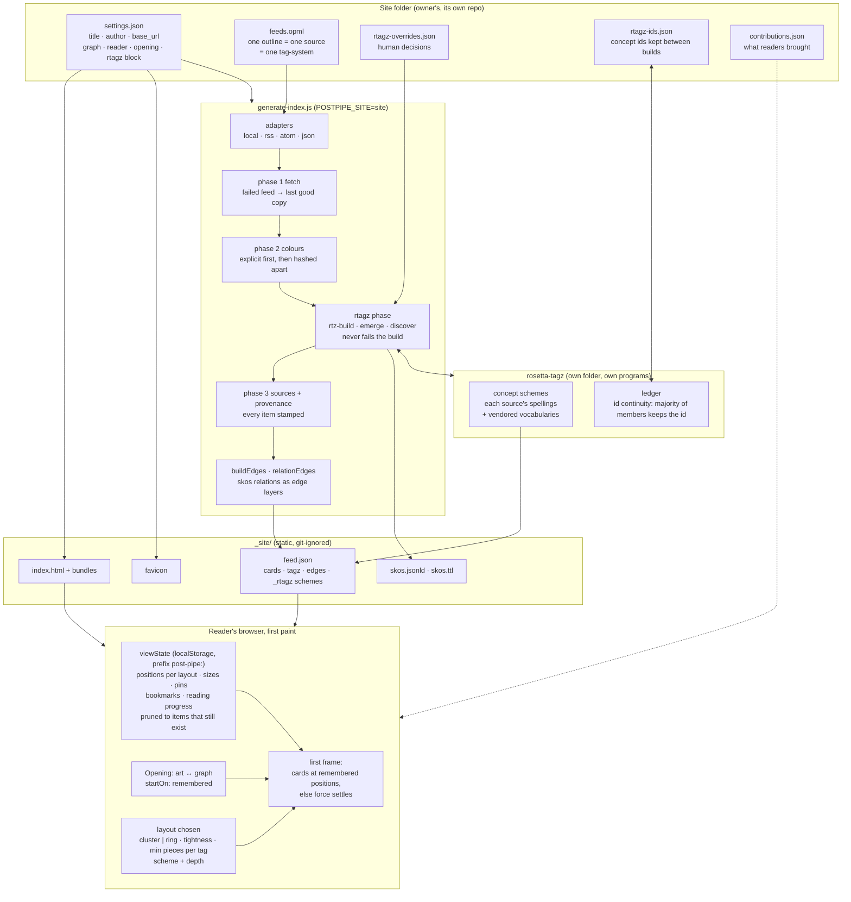
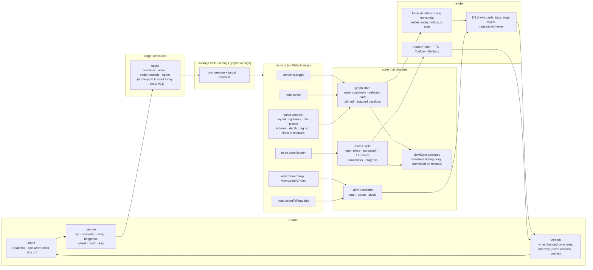
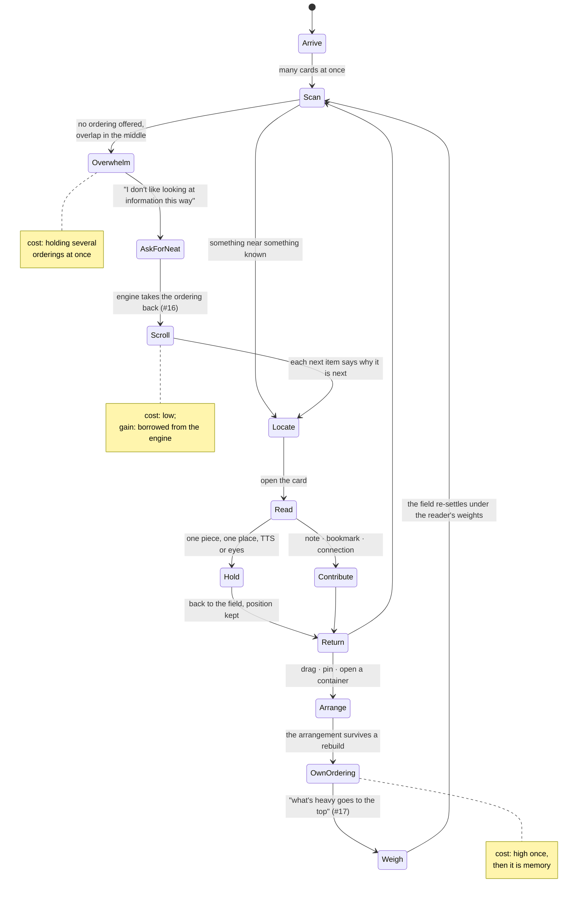

# post-pipe systems graph

#post-pipe #systems #diagram #neat-view #rtagz #cognition

One graph, entered from two doors. **Launch** is everything that exists before a reader touches anything. **Input** is one gesture travelling through the system and coming back out as something the reader perceives. A third layer draws the reader as a system too, with states and the moves between them, so the machine side and the mind side are drawn the same way.

Files appear only as the place a state lives. Where a line is inferred rather than read from the code, it carries `?`; those are the lines for a droid to confirm. Related: [[POST-PIPE-USES-RTAGZ]], [[SITES]], [[ACTIONS]], issues #16 #17 #22.

---

## 1. Launch — the state before anyone arrives

What holds still across a rebuild: the card's slug, the tag's concept id (through the ledger), and the reader's arrangement (through viewState, keyed by those ids). Everything else may move. That triad is the floor the ring layout, the neat view and reader-built orderings stand on.

---

## 2. Input — one gesture through the system

The viewer never decides what a tap does; it asks the table. That is the engine's one concession to the reader's side already in place: the meaning of a gesture is a setting, not code. The neat view (#16) and reader-built orderings (#17) extend the same move to *what comes first*.

---

## 3. The reader as a system

Drawn with the same shape as the machine: states, and the moves between them. The costs are working-memory costs. Nothing here is a diagnosis; it is what a person has to do to use the thing.

The operations a reader performs, named once: **scanning** a field rather than a line; **choosing one ordering** or accepting the engine's; **holding more than one ordering at once**; **tolerating overlap** where the vocabulary is shared; **reading from a shared vocabulary** rather than a private one (that is what rtagz buys them); **letting go of neatness**, or asking for it back. The last two are a toggle, not a stage. Zettelkasten keepers kept the box and the sequential index both; this map keeps the graph and the scroll both.

---

## 4. Where the two meet

| exchange | engine side | reader side | state today |
|---|---|---|---|
| what a gesture means | bindings table | gesture → intent | built (ACTIONS.md) |
| where things are | viewState by stable id | arrangement memory | built |
| what a tag is called | rtagz schemes, scheme chosen in panel | shared vocabulary | built, deepening (IPTC next) |
| how deep to look | depth slider; folded lines as an option | granularity | in this release |
| what comes first | layout forces; ring radius attribute (#18) | one ordering vs. many | partly built |
| the scroll | neat view (#16) | low-cost default | not built |
| whose weights | reader-built orderings (#17) | own algorithm | not built |
| what a point means | nearest-wins / region select (#21) | pointing in a crowd | not built |

---

## To confirm (`?` lines)

- Whether `contributions.json` is read at launch or on opening a piece.
- Whether `startOn: remembered` falls back to art or graph on a first visit with no storage.
- Whether drag positions are stored per layout (`placeOf(layout) + persistKey`) in all layouts or only force and ring.
- Whether the tag list / min-pieces slider writes to viewState or only to in-memory panel state.

---

#post-pipe/systems #post-pipe/neat-view #flow-session/2026-10-31
